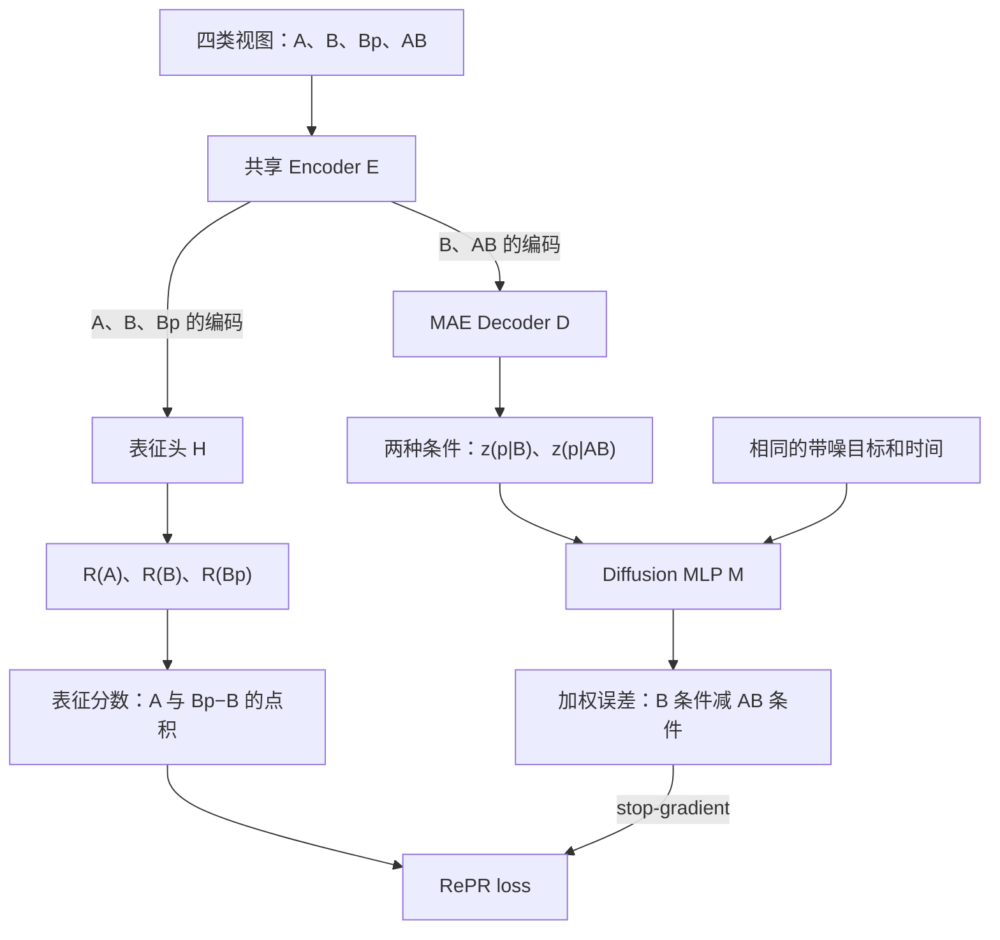

# RePR 中文解读：Figure 1、真实代码与训练流程

- **论文**：**Generative Representation Learning for Scalable Latent Tokenization**
- **上游仓库**：[AlanBaade/repr](https://github.com/AlanBaade/repr)
- **本文核对版本**：[`0983ba693f443dc5344ff1769fe4874264203c42`](https://github.com/AlanBaade/repr/tree/0983ba693f443dc5344ff1769fe4874264203c42)

阅读范围：围绕 Figure 1 解释方法实现，结合源码补充 mask、损失、梯度和训练调度，不替代论文第 4 节的完整理论推导。

本中文注释版仅增加 Python `#` 注释、本文与 README 入口；保留原有代码逻辑、默认参数、英文注释、docstring 和许可证。

## 目录

1. [Figure 1 的核心关系](#1-figure-1-的核心关系)
2. [A、B、AB、Bp 的含义](#2-ababbp-的含义)
3. [共享 encoder 的真实调用](#3-共享-encoder-的真实调用)
4. [MAE 如何生成目标位置的条件](#4-mae-如何生成目标位置的条件)
5. [Diffusion MLP 的输入与时间约定](#5-diffusion-mlp-的输入与时间约定)
6. [加权 PMI 目标怎样计算](#6-加权-pmi-目标怎样计算)
7. [空间和全局表征如何生成](#7-空间和全局表征如何生成)
8. [损失与梯度路径](#8-损失与梯度路径)
9. [一次训练步骤和第二轮训练](#9-一次训练步骤和第二轮训练)
10. [张量与重复次数速查](#10-张量与重复次数速查)
11. [代码阅读顺序与文件说明](#11-代码阅读顺序与文件说明)
12. [配置与实际运行时需要分清的细节](#12-配置与实际运行时需要分清的细节)
13. [论文示意图和代码实现的差异](#13-论文示意图和代码实现的差异)
14. [注释范围与验证方式](#14-注释范围与验证方式)

## 1. Figure 1 的核心关系

**Figure 1 下方的 $B$ 和 $AB$ 确实都进入 MAE。MAE 先产生目标位置的条件特征，再由 diffusion MLP 根据这个条件预测目标 patch。**

图中三个模块的关系是：

$$
\boxed{\text{图中的 MAE}=E_\theta+D_\theta}
$$

$$
\boxed{\text{生成预测分支}=E_\theta+D_\theta+M_\theta}
$$

$$
\boxed{\text{表征分支 }R_\theta=E_\theta+H_\theta}
$$

这里用 $H_\theta$ 统称源码中的表征头。两条分支共用同一个 $E_\theta$，之后分别进入生成 decoder 或表征头。源码没有一个独立叫作 `MAE` 的类；图中的 MAE 框对应 encoder 与生成 decoder 的组合。

| 图中模块 | 真实代码 | 作用 |
|---|---|---|
| Encoder $E_\theta$ | `self.encoder` | 编码当前视图允许使用的上下文 |
| MAE Decoder $D_\theta$ | `self.decoder` | 补入 mask token，产生各位置的条件特征 |
| Diffusion MLP $M_\theta$ | `self.diff_mlp` | 接收带噪目标、时间和条件，预测干净目标 |
| 表征头的 self-attention | `self.repr_encoder` | 进一步处理 encoder 输出，共 3 层 |
| 表征头的 cross-attention | `self.representation_encoder` | 从上下文读取信息，生成空间输出，共 3 层 |
| 表征输出投影 | `repr_final_layer`、`repr_final_layer_global` | 分别输出空间表征和全局 register 表征 |

下面的共享 encoder 节点表示**同一套参数分别处理不同视图**，不表示不同视图的 token 可以相互注意。



来源：[模块定义，原始 L542–592](https://github.com/AlanBaade/repr/blob/0983ba693f443dc5344ff1769fe4874264203c42/model_repr.py#L542-L592)、[联合前向，原始 L995–1120](https://github.com/AlanBaade/repr/blob/0983ba693f443dc5344ff1769fe4874264203c42/model_repr.py#L995-L1120)。

## 2. A、B、AB、Bp 的含义

用 patch 编号举例：

$$
A=\{4,7\},\qquad B=\{1,4\},\qquad p=9.
$$

于是：

$$
AB=A\cup B=\{1,4,7\},
\qquad
Bp=B\cup\{p\}=\{1,4,9\}.
$$

$A$ 和 $B$ 可以重叠。$AB$ 是可见内容的并集，重叠位置只占一个空间位置；$Bp$ 表示在背景视图 $B$ 中额外暴露本次目标 $p$。

| 视图 | 可见位置示例 | 共享 $E$ | 生成 $D$ | 表征头 $H$ |
|---|---|---|---|---|
| $A$ | $\{4,7\}$ | 使用 | 不使用 | 得到 $R(A)$ |
| $B$ | $\{1,4\}$ | 使用 | 得到预测 $p$ 的条件 | 得到 $R(B)$ |
| $AB$ | $\{1,4,7\}$ | 使用 | 得到预测 $p$ 的条件 | 不使用 |
| $Bp$ | $\{1,4,9\}$ | 使用 | 不使用 | 得到 $R(Bp)$ |

### 2.1 mask 的 True 表示遮挡

因此可见集合的并集在代码中写成 mask 的交集：

```python
is_mask_AB = is_mask_A & repeat(is_mask_B, 'B N -> (R B) N', R=R)
```

只有同时被 $A$ 和 $B$ 遮住的位置，在 $AB$ 中才仍然遮住。

构造 $Bp$ 则把目标位置从 $B$ 的遮挡集合中移除：

```python
is_mask_background_bp = repeat(is_mask_background, 'B N -> P B N', P=P) & (~is_bp)
```

block 策略先尽量选择在多个 $A$ 中共同被遮住的候选 $p$，但并不保证每个候选对每个 $A$ 都不可见。最后通过 `is_valid_B & is_valid_A` 筛选，只有满足 $p\notin A\cup B$ 的配对才计入 PMI loss。

### 2.2 为什么下方用 B、AB，上方用 A、B、Bp？

生成分支回答：

> 已经知道 $B$ 时，再给模型看 $A$，会让同一个目标 $p$ 更容易预测多少？

普通、未加权的理想概率目标是：

$$
\log P(p\mid A,B)-\log P(p\mid B).
$$

它与增量 PMI 有关：

$$
\operatorname{PMI}(A;B,p)-\operatorname{PMI}(A;B)
=
\log\frac{P(p\mid A,B)}{P(p\mid B)}.
$$

上方希望用表征的增量表达这份信息：

$$
\left\langle R(A),R(Bp)-R(B)\right\rangle.
$$

实际实现进一步使用加权去噪误差构造目标，见第 6 节。这里的概率式用于解释为什么要比较两种上下文，不意味着代码精确输出普通的 $\log P$。

来源：[mask 构造，原始 L774–814](https://github.com/AlanBaade/repr/blob/0983ba693f443dc5344ff1769fe4874264203c42/model_repr.py#L774-L814)、[有效配对与匹配目标，原始 L1103–1120](https://github.com/AlanBaade/repr/blob/0983ba693f443dc5344ff1769fe4874264203c42/model_repr.py#L1103-L1120)。概率恒等式是对理想 PMI 定义的直接代数推导。

## 3. 共享 encoder 的真实调用

核心函数是 [`REPR.forward_repr()`](model_repr.py)。

它先把 $B$、$A$、$Bp$ 沿 **batch 维** 拼接：

```python
is_selected_BABp = torch.cat([is_selected_B, is_selected_A, is_selected_Bp], 0)
is_mask_BABp = torch.cat([is_mask_B, is_mask_A, is_mask_Bp], 0)
```

然后：

```python
z_e_BABp = get_encoded(z_BABp, is_selected_BABp, is_mask_encoder_BABp)
z_e_AB = get_encoded(z_AB, is_selected_AB, is_mask_encoder_AB)
```

两次 `get_encoded()` 都循环调用同一个 `self.encoder`。

### 3.1 BABp 是批处理顺序

`z_e_BABp` 依次装着 $B$、多个 $A$、多个 $Bp$ 的编码结果。不同 batch 样本的 attention 独立运行，不会因为 `torch.cat(..., dim=0)` 而相互读取内容。

其中 `B_IN` 是输入图像 batch size，不是视图 $B$ 的 patch 数：

```python
z_e_BABp[:B_IN]
```

这部分正是 $E(B)$。

### 3.2 E(B) 的结果被直接复用

生成分支从上述切片中取出 $E(B)$，与单独算出的 $E(AB)$ 一起组装 decoder 输入：

```python
z_d_BAB_nomaskpos = torch.cat([z_d_B_nomaskpos, z_d_AB_nomaskpos], dim=0)
```

同时，整个 `z_e_BABp` 继续进入表征头，用来产生 $R(B)$、$R(A)$、$R(Bp)$。

因此，图上两个位置出现 $B$，代表同一个视图的两种用途。源码明确复用了同一份 encoder 计算。

来源：[视图打包与 encoder，原始 L944–1007](https://github.com/AlanBaade/repr/blob/0983ba693f443dc5344ff1769fe4874264203c42/model_repr.py#L944-L1007)、[decoder 连接，原始 L1009–1031](https://github.com/AlanBaade/repr/blob/0983ba693f443dc5344ff1769fe4874264203c42/model_repr.py#L1009-L1031)。

## 4. MAE 如何生成目标位置的条件

### 4.1 Encoder：编码允许看到的内容

逻辑上：

$$
h_B=E_\theta(B),\qquad h_{AB}=E_\theta(A\cup B).
$$

有效 PMI 样本中，生成上下文不能使用真实目标 $p$ 的内容。

### 4.2 固定长度补齐与 attention 隔离

源码的实际 encoder 张量可能包含若干被遮住位置的原始 patch embedding，作为固定长度的补齐项。因此，“encoder 的实际张量中只有可见 patch”并不准确。

防止泄露的机制是：

1. `is_selected` 固定选择一定数量的位置，并优先保留可见项。
2. `get_attention_mask()` 以 `q == k` 将可见组与遮挡补齐组隔离。
3. register/in-context token 被归入可见组。
4. 进入生成 decoder 前，所有遮挡位置都替换成 `mask_token`，丢弃补齐项中编码的真实内容。
5. 表征 cross-attention 只允许读取有效可见上下文和 register。

因此，阅读源码时要区分“张量中是否存在某个位置”与“有效预测路径是否可以读取该位置的真实内容”。

### 4.3 Decoder：补回完整网格

decoder 先将 encoder 输出放回其空间位置，遮挡位置使用 mask token，再加入位置编码并运行全序列 attention。其输出仍然是 hidden feature。

取目标位置得到：

$$
z_{p\mid B}=[D_\theta(E_\theta(B))]_p,
$$

$$
z_{p\mid AB}=[D_\theta(E_\theta(A\cup B))]_p.
$$

这两个式子将补 mask token、位置编码和 register 处理包含在 $D_\theta$ 中。

条件特征表达的是“根据当前上下文，目标位置应如何预测”。真正的像素预测在后面的 diffusion MLP 中完成。

来源：[attention 分组，原始 L667–670](https://github.com/AlanBaade/repr/blob/0983ba693f443dc5344ff1769fe4874264203c42/model_repr.py#L667-L670)、[固定长度选择，原始 L800–811](https://github.com/AlanBaade/repr/blob/0983ba693f443dc5344ff1769fe4874264203c42/model_repr.py#L800-L811)、[encoder/decoder，原始 L995–1031](https://github.com/AlanBaade/repr/blob/0983ba693f443dc5344ff1769fe4874264203c42/model_repr.py#L995-L1031)、[表征可见性，原始 L1073–1082](https://github.com/AlanBaade/repr/blob/0983ba693f443dc5344ff1769fe4874264203c42/model_repr.py#L1073-L1082)。

## 5. Diffusion MLP 的输入与时间约定

### 5.1 代码中的 t 是干净目标的权重

源码使用：

$$
p_t=t\,p+(1-t)\epsilon,\qquad \epsilon\sim\mathcal N(0,I).
$$

所以 $t=0$ 为纯噪声，$t=1$ 为干净目标。论文简化伪代码可能采用相反的时间参数化；对照本仓库时，以这里的实际表达式为准。

```python
x_bp_vpr_noisy = t_bp_vpr * x_bp_vpr + (1-t_bp_vpr) * eps_bp_vpr
```

### 5.2 MLP 同时接收三项输入

$$
\hat p_B=M_\theta(p_t,t,z_{p\mid B}),
\qquad
\hat p_{AB}=M_\theta(p_t,t,z_{p\mid AB}).
$$

`SimpleMLPAdaLN.forward(self, x, t, c)` 的实际主体是：

```python
x = self.input_proj(x)
t = self.time_embed(t)
c = self.cond_embed(c)

y = t + c

for block in self.res_blocks:
    x = block(x, y)

return self.final_layer(x, y)
```

| 参数 | 含义 |
|---|---|
| `x` | 带噪目标 $p_t$ |
| `t` | 噪声时间 |
| `c` | decoder 产生的条件特征 |

输出直接与干净 $p$ 比较，属于 clean-target prediction。$p_t$ 单独进入 MLP，不作为生成分支的 MAE 输入。

MAE 的条件特征可以缓存复用，较轻的 MLP 再在不同时间和噪声下反复运行。这是该结构用于估计 PMI 时的计算优势。

来源：[MLP 主体，原始 L451–468](https://github.com/AlanBaade/repr/blob/0983ba693f443dc5344ff1769fe4874264203c42/model_repr.py#L451-L468)、[加噪与调用，原始 L1047–1063](https://github.com/AlanBaade/repr/blob/0983ba693f443dc5344ff1769fe4874264203c42/model_repr.py#L1047-L1063)。

## 6. 加权 PMI 目标怎样计算

### 6.1 使用同一目标、同一时间、同一噪声

代码先采样形状为 `(V, P, B_IN)` 的时间和相应噪声，再沿条件轴重复。对一个目标和一次 Monte Carlo 采样，$B$ 与所有 $AB$ 条件共享相同的 $p_t$、$t$ 和 $\epsilon$。

这样，误差比较主要反映上下文变化，而不会额外混入两次独立噪声的差异。

### 6.2 误差的方向是 B 减 AB

实现中的目标为：

$$
\widehat{s}(A,p\mid B)
=
\frac{1}{V}\sum_{v=1}^{V}
g(t_v)
\left[
\|\hat p_{B,v}-p\|_2^2
-
\|\hat p_{AB,v}-p\|_2^2
\right],
$$

其中：

$$
g(t)=\frac{t}{2\max(1-t,0.33)^2}.
$$

源码先对目标通道求平方和：

```python
freq_weight = 1/2*t_bp_vpr/(1-t_bp_vpr).clamp_min(0.33).pow(2)
h_p_vprb = freq_weight * (x_bp_vpr_pred - x_bp_vpr).pow(2).sum(-1, True)
```

随后重排形状，并计算：

```python
pmi_target = (h_p_given_B_preintegration - h_p_given_BA_preintegration).mean(-1)
```

### 6.3 数值例子

假设某一次相同噪声下：

$$
\|\hat p_B-p\|^2=10,\qquad \|\hat p_{AB}-p\|^2=3.
$$

这一项提供正贡献：

$$
g(t)(10-3)=7g(t)>0.
$$

即加入 $A$ 改善了对 $p$ 的预测。上方表征点积应学习相应的正关系。这个数值例子仅用于说明符号方向，并非实验结果；实际估计不保证每一次采样都为正。

### 6.4 32 次评估的含义

README 设置 `diff_repeat_repr=32`，即 $V=32$。它表示在不同噪声和时间下估计目标的 Monte Carlo 次数，不是连续执行 32 步去噪生成。

`t` 来自 logit-normal：

$$
t=\sigma(u),\qquad u\sim\mathcal N(\mu_{\mathrm{repr}},\sigma_{\mathrm{repr}}^2).
$$

MAR 训练的时间采样另混入 10% 的均匀采样；PMI 估计这段没有这一混合。

### 6.5 为什么不能直接叫作精确 log P？

这里同时存在时间分布、加权、分母截断、有限 Monte Carlo 次数和预测模型误差。因此应称为“实现中的加权 PMI 估计/训练目标”。图中带引号的 likelihood 分数不能直接解释为精确、归一化的普通条件概率。

来源：[时间分布与误差权重，原始 L1033–1063](https://github.com/AlanBaade/repr/blob/0983ba693f443dc5344ff1769fe4874264203c42/model_repr.py#L1033-L1063)、[相减与平均，原始 L1109–1114](https://github.com/AlanBaade/repr/blob/0983ba693f443dc5344ff1769fe4874264203c42/model_repr.py#L1109-L1114)、[README 配置](https://github.com/AlanBaade/repr/blob/0983ba693f443dc5344ff1769fe4874264203c42/README.md#L23-L35)。

## 7. 空间和全局表征如何生成

### 7.1 空间路径是 18 + 3 + 3 层

仓库的 XT/T/S/B/L 工厂函数均设置：

- 主 encoder：18 层；
- 生成 decoder：6 层；
- 表征头额外 self-attention：3 层；
- 表征头 cross-attention：3 层。

空间表征的实际路径为：

$$
X_{\mathrm{view}}
\xrightarrow{E_{18}}
h
\xrightarrow{H_{\mathrm{self},3}}
h'
\xrightarrow{H_{\mathrm{cross},3}}
r
\xrightarrow{\mathrm{projection}}
R(X_{\mathrm{view}}).
$$

裸 `REPR.__init__` 的参数默认值中 `depth=24`，但训练通过工厂函数实例化，应以工厂显式传入的 18 为准。

### 7.2 Figure 1 右侧的 Q、K、V

第一层 cross-attention：

- Q 的输入来自相对当前可见区域中心的位置 embedding；
- K、V 来自 $E$ 后再经过 3 层 self-attention 的上下文；
- cross-attention 不允许读取遮挡补齐 token。

代码先令：

```python
repr_tokens = repr_factor_pos_pad
```

再反复更新：

```python
for block in self.representation_encoder:
    repr_tokens = block(repr_tokens, z_e, q_rope, k_rope, attn_mask=attn_mask)
```

“Query 只有位置信息”仅描述初始输入。第一层后，query token 已吸收图像内容，后续层继续更新它。

源码用可见位置坐标的整数平均定义中心；空视图通过分母截断避免除零，并在后续把相应 $A/B$ 表征置零。不要把实现中的中心索引误认为连续质心。

### 7.3 register 的 RoPE 不能一概描述为可见中心

在表征 cross-attention 的 K 路径中，代码显式传入 `cls_idx=cls_rope_idx`，此时 register 使用可见中心位置。

但主 encoder 和额外 self-attention 的 RoPE 调用没有传入这个 `cls_idx`；对应实现会使用选中序列中第一个未 mask token 的位置作为默认 register 位置。decoder 的普通调用又有其默认位置处理。应分别阅读 `VisionRotaryEmbeddingFast.forward()` 的分支，不把图示中的中心概念推广到所有调用。

### 7.4 R(Bp) 中新增目标有专门标记

$Bp$ 的新增目标位置会加上 `self.is_b_embed`，使网络知道哪一个位置是本次增量目标。这个变量名容易误读：实际标记的是目标 $p$，并非整个 $B$。

第一轮中该位置使用真实像素 patch 的 embedding。第二轮中，该位置可使用 frozen teacher 的 feature，经 `feats_embedder` 投影后加入；其他上下文仍来自当前图像的像素嵌入。

### 7.5 空间差值比较整张表征图

$B$ 和 $Bp$ 分别完整编码；不是在已有的 $E(B)$ hidden state 上做一次局部增量更新。

$$
\Delta R=R(Bp)-R(B).
$$

一个新增输入 patch 可以改变多个输出位置的特征。代码对全部空间位置和特征通道求点积，并包含尺度因子。忽略 padding dropout 和无效配对处理时：

$$
s_{\mathrm{spatial}}
=
\frac{\sqrt{d_E}}{2d_R\sqrt Q}
\sum_{q=1}^{Q}
\left\langle R_q(A),R_q(Bp)-R_q(B)\right\rangle.
$$

$d_E$ 是 encoder hidden size，$d_R$ 是输出维度，$Q$ 是空间位置数量。

### 7.6 默认输出有一圈 padding

以 README 的 $256\times256$ 图像、patch size 16 为例：

$$
16\times16\text{ 个原图位置}
\longrightarrow
18\times18=324\text{ 个空间 query}.
$$

代码向四边各扩展一格。`pad_dropout` 有概率将 $A/B$ 输出的外圈置零；默认训练空间点积涉及这些 padded 位置。

`forward_feats(x, return_padded=True)` 默认返回扩展网格；设为 `False` 时返回原图的 $16\times16$ 位置。

### 7.7 还有一条 global 分支

global representation 来自 $E+3$ 层 self-attention 后的 register token。每个 register 经 `repr_final_layer_global` 投影后拼接，得到一个全局向量；这条分支不经过 3 层 cross-attention。

它也构造：

$$
s_{\mathrm{global}}
=
\frac{
\langle G(A),G(Bp)-G(B)\rangle
}{
2\sqrt{d_G}
},
$$

并匹配相同的 PMI target。其中 $d_G$ 为拼接后的 global 向量维度。

来源：[基础 RoPE，原始 L84–121](https://github.com/AlanBaade/repr/blob/0983ba693f443dc5344ff1769fe4874264203c42/model_repr.py#L84-L121)、[位置与角色嵌入，原始 L950–993](https://github.com/AlanBaade/repr/blob/0983ba693f443dc5344ff1769fe4874264203c42/model_repr.py#L950-L993)、[表征与分数，原始 L1065–1118](https://github.com/AlanBaade/repr/blob/0983ba693f443dc5344ff1769fe4874264203c42/model_repr.py#L1065-L1118)、[模型工厂，原始 L1219–1245](https://github.com/AlanBaade/repr/blob/0983ba693f443dc5344ff1769fe4874264203c42/model_repr.py#L1219-L1245)。

## 8. 损失与梯度路径

### 8.1 Stop-gradient 只切断监督目标这条反向路径

PMI 目标的预测与误差计算放在：

```python
with torch.no_grad():
    ...
```

因此 RePR loss 不通过 target 反传到生成 decoder/MLP。但生成分支仍通过外部的 MAR loss 学习。

| 参数模块 | MAR loss | RePR spatial/global loss |
|---|---|---|
| 共享 encoder $E$ | 更新 | 更新 |
| 生成 decoder $D$ | 更新 | 不经 target 更新 |
| Diffusion MLP $M$ | 更新 | 不经 target 更新 |
| 表征头 $H$ 与输出投影 | 不使用 | 更新 |

停止目标梯度不代表生成模型整体冻结，也不代表模型采用 EMA teacher。

### 8.2 联合训练中的 MAR 覆盖 B 和 AB

`forward_repr()` 的 decoder batch 是 `[B, AB]`：

- $B$ 分支训练其遮挡位置；
- $AB$ 分支最终只训练仍被 $A$、$B$ 同时遮挡的位置。

为固定张量长度，候选目标会包含部分最后被有效性 mask 清零的位置。理解损失时应同时看候选选择和最终 `mse_is_valid`。

单独的 `forward_mar()` 则只使用 $AB$ 条件。

### 8.3 实际使用 Huber

代码虽然使用 `mse_loss` 变量名，但 MAR 和 RePR 匹配均使用 `2 * F.huber_loss`：

$$
2\,\operatorname{Huber}_\delta(e)
=
\begin{cases}
e^2,& |e|\le\delta,\\
2\delta|e|-\delta^2,& |e|>\delta.
\end{cases}
$$

MAR 的阈值为 10，并除以 $\max(1-t,0.33)^2$；RePR 使用 `repr_delta`。

总损失是：

$$
L=L_{\mathrm{MAR}}
+\lambda L_{\mathrm{RePR,spatial}}
+\lambda L_{\mathrm{RePR,global}}.
$$

PMI target 本身的计算仍使用平方误差；Huber 是用于训练预测模型和匹配表征分数的损失。不要把这两处混为一谈。

来源：[联合 MAR 与 no-grad，原始 L1033–1063](https://github.com/AlanBaade/repr/blob/0983ba693f443dc5344ff1769fe4874264203c42/model_repr.py#L1033-L1063)、[总损失，原始 L1116–1120](https://github.com/AlanBaade/repr/blob/0983ba693f443dc5344ff1769fe4874264203c42/model_repr.py#L1116-L1120)、[纯 MAR，原始 L884–912](https://github.com/AlanBaade/repr/blob/0983ba693f443dc5344ff1769fe4874264203c42/model_repr.py#L884-L912)。Huber 分段式为该损失定义的直接展开。

## 9. 一次训练步骤和第二轮训练

### 9.1 每四步的调度

`ReprDenoiser.forward_repr_mar()` 以 `train_step` 为计数器：

```python
if step % 4 == 0:
    return self.forward_repr(x)
else:
    loss = self.net.forward_mar(x)
```

所以从 step 0 开始，顺序是联合、MAR、MAR、MAR，再重复。联合步同时训练生成与表征，其余三步只训练生成分支。共享 encoder 在两类步骤中都会更新。

### 9.2 联合步的等价阅读流程

下面是便于理解的流程描述，不是可以直接替换源码的简化实现：

1. 将图像 patchify，并构建 $A$、$B$、$Bp$、$AB$。
2. 用同一 encoder 分别编码这些视图。
3. 将 $E(B)$、$E(AB)$ 补回完整网格，运行生成 decoder。
4. 对遮挡目标计算 MAR loss，保留梯度。
5. 在 no-grad 中，对选中的目标 $p$ 重复采样时间和噪声。
6. 使用同一带噪目标比较 $B$、$AB$ 条件，得到加权 PMI target。
7. 由 $E(A)$、$E(B)$、$E(Bp)$ 生成空间和全局表征。
8. 计算表征点积增量，过滤无效配对，用 Huber 匹配 target。
9. 三项 loss 加权相加，再由训练循环执行 backward 和 optimizer step。

### 9.3 第二轮改变目标空间

在 `repr_mar_featspred` 模式中：

- 加载上一轮模型到 `frozen_net`；
- 对其调用 `requires_grad_(False)`，并在 eval/no-grad 下提取完整图像特征；
- 使用 `forward_feats(x, return_padded=False)` 得到原图位置的 feature target；
- 乘以 `teacher_feats_mul` 后，作为本轮的去噪目标；
- MLP 的输入/输出通道从像素 patch 维度切换为 `repr_dim`；
- $Bp$ 的新增目标也按 feature target 进行嵌入。

上下文图像的共享 encoder 仍读取像素 patch。冻结上一轮的模型与本轮 PMI 估计中的 no-grad 是两种不同机制。

### 9.4 表征提取

`forward_feats()` 使用：

$$
X\rightarrow E_\theta\rightarrow H_\theta\rightarrow R_\theta(X).
$$

函数返回 `(spatial, global_features)`，不调用生成 decoder 和 diffusion MLP。

`ReprDenoiser.update_ema()` 在当前代码中是 `pass`。继承文件 `denoiser.py` 中的旧 JiT EMA 逻辑不属于当前 RePR 主训练路径。

来源：[训练调度与第二轮，原始 L91–118](https://github.com/AlanBaade/repr/blob/0983ba693f443dc5344ff1769fe4874264203c42/denoiser_repr.py#L91-L118)、[冻结上一轮参数，原始 L35–60](https://github.com/AlanBaade/repr/blob/0983ba693f443dc5344ff1769fe4874264203c42/denoiser_repr.py#L35-L60)、[特征导出，原始 L1125–1216](https://github.com/AlanBaade/repr/blob/0983ba693f443dc5344ff1769fe4874264203c42/model_repr.py#L1125-L1216)、[EMA 空实现](https://github.com/AlanBaade/repr/blob/0983ba693f443dc5344ff1769fe4874264203c42/denoiser_repr.py#L143-L144)。

## 10. 张量与重复次数速查

以 README 的第一轮命令为例：图像 256，patch size 16，REPR-B/16 的 hidden size 768，`repr_dim=1024`，register 数为 16。

| 量 | 含义 | 示例 |
|---|---|---|
| `B_IN` | 进入当前前向函数的图像数量 | 依数据批量和 repeat 设置而定 |
| `N` | 原图 patch 数 | $16^2=256$ |
| `d` | encoder/decoder hidden size | 768 |
| `patch_dim` | 第一轮目标 patch 展平维度 | $3\times16\times16=768$ |
| `R` | 每张图像的 $A$ 视图重复数 | $1\times8=8$ |
| `R1` | 生成条件轴，包含一个 $B$ 和 $R$ 个 $AB$ | 9 |
| `P` | 每张图像的候选目标 patch 数 | 16 |
| `O` | MAR loss 的时间/噪声重复数 | 4 |
| `V` | PMI 目标估计的时间/噪声重复数 | 32 |
| `Q` | padded 空间表征位置数 | $18^2=324$ |
| 空间输出 | `[B_IN, Q, repr_dim]` | `[B_IN, 324, 1024]` |
| 全局输出 | `[B_IN, in_context_len * repr_dim]` | `[B_IN, 16384]` |

`z_e_BABp` 的 batch 轴长度是 $(1+R+P)B_{\mathrm{IN}}$；`z_e_AB` 是 $RB_{\mathrm{IN}}$。两次 encoder 前向允许采用不同的固定 token 长度。

在这个配置下，$A/B/Bp$ 的选中空间位置数为：

$$
\max(N-a_{\min\_mask},\,b_{\max\_visible}+1)=\max(64,17)=64.
$$

加上 16 个 register，encoder 序列长度为 80。$AB$ 的选中位置数为 $64+16=80$，加 register 后为 96。生成 decoder 补齐为 $256+16=272$ 个 token。

这些是特定 README 配置下的张量长度，不应推广为所有分辨率或参数的固定值。

来源：[README 配置](https://github.com/AlanBaade/repr/blob/0983ba693f443dc5344ff1769fe4874264203c42/README.md#L23-L38)、[repeat 传入](https://github.com/AlanBaade/repr/blob/0983ba693f443dc5344ff1769fe4874264203c42/denoiser_repr.py#L10-L32)、[固定长度选择](https://github.com/AlanBaade/repr/blob/0983ba693f443dc5344ff1769fe4874264203c42/model_repr.py#L800-L811)、[重复轴定义](https://github.com/AlanBaade/repr/blob/0983ba693f443dc5344ff1769fe4874264203c42/model_repr.py#L935-L948)。

## 11. 代码阅读顺序与文件说明

建议先读 `denoiser_repr.py` 的调度，再读 `model_repr.py` 的 `forward_repr()`，遇到模块或 mask 函数时回查定义，最后查看入口和训练循环。

| 文件 | 阅读重点 |
|---|---|
| [model_repr.py](model_repr.py) | RePR 主模型；基础模块、μP 参数组、mask、共享 E、MAR、PMI、空间/全局表征、特征导出 |
| [denoiser_repr.py](denoiser_repr.py) | 模型装配、每四步调度、第二轮冻结目标、padding dropout 调度、统计接口 |
| [main_jit.py](main_jit.py) | 参数解析、数据流、分布式训练、学习率、optimizer、checkpoint |
| [engine_jit.py](engine_jit.py) | 一个 epoch 内的归一化、BF16、loss/backward/step 和日志 |
| [util/lr_sched.py](util/lr_sched.py) | warmup、constant/cosine/wsd 与各参数组 lr_scale |
| [util/gpic.py](util/gpic.py) | GPIC WebDataset 流、分片、随机裁剪与 batch |
| [util/crop.py](util/crop.py) | ImageNet 中心裁剪 |
| [util/misc.py](util/misc.py) | 指标聚合、DDP 初始化、保存与继承的训练辅助工具 |
| [util/model_util.py](util/model_util.py) | RoPE、RMSNorm 和固定 sin/cos 位置编码等 JiT 继承工具；需区分哪些被 RePR 主线实际调用 |
| [model_jit.py](model_jit.py) | 继承的 JiT 图像 Transformer，不是 RePR 主模型 |
| [denoiser.py](denoiser.py) | 继承的 JiT 去噪/CFG/采样/EMA 包装，不是 main_jit 的当前 RePR 包装 |
| [prepare_ref.py](prepare_ref.py) | JiT/FID 相关参考数据准备，保留上游用途 |

各文件的中文注释以函数职责、输入输出、关键张量形状和容易误读的控制流为主。继承代码中的 EMA、CFG、ODE 采样应按其各自的调用路径理解，不能套到 RePR 的 PMI 估计上。

## 12. 配置与实际运行时需要分清的细节

### 12.1 CLI 默认值与论文示例命令不是一回事

以下为该 commit 的部分 CLI 默认值与 README 第一轮示例的区别：

| 参数 | main_jit CLI 默认值 | README 第一轮示例 |
|---|---|---|
| `in_context_len` | 1 | 16 |
| `repr_dim` | 4096 | 1024 |
| `global_batch_repeat` | 1 | 8 |
| `p_repeat` | 8 | 16 |
| `b_max_visible` | 48 | 16 |
| `a_min_mask` | $256-76=180$ | 192 |
| `repr_loss_weight` | 0.1 | 0.005 |
| `lr_schedule` | constant | wsd |

解释论文设置或复现示例时，应看完整命令中覆盖了哪些值。

### 12.2 global_batch_repeat 不是梯度累积

数据层每个 rank 读入的图像数量为：

$$
B_{\mathrm{loader}}=
\frac{\texttt{batch\_size}}{\texttt{global\_batch\_repeat}}.
$$

模型内部相应增加 mask repeats。入口仍以：

$$
B_{\mathrm{effective}}
=
\texttt{batch\_size}\times\texttt{world\_size}
$$

进行学习率缩放，未显式指定 `lr` 时：

$$
\mathrm{lr}
=
\mathrm{blr}\times\frac{B_{\mathrm{effective}}}{256}.
$$

优化器参数组还有 μP 的 `lr_scale`，调度器会保留这些相对比例。入口打印的 `args.lr` 是调度基准；训练循环和 TensorBoard 记录的 `lr` 则来自 `optimizer.param_groups[0]['lr']`，已经包含该参数组的缩放。不同参数组的实际学习率也可能不同。

### 12.3 数据与统计接口

使用 ImageNet 时，入口要求 WebDataset 格式的 `train/*.tar`；另有 `--dataset gpic` 的远程流式数据分支。图像在训练循环中从 uint8 映射到 $[-1,1]$，而不是先做 ImageNet mean/std normalization。

当前入口按 CUDA/DDP 路线组织，不能只因为存在 `--device` 参数就假定单进程 CPU 路线已被完整支持。

`get_stats` 当前从主进程读取一个 batch，统计并保存特征的均值与标准差。它不是自动遍历完整数据集的统计评估。

具体训练命令保留在原始 [README.md](README.md)；数据路径、checkpoint 路径需要按自己的环境设置。

来源：[入口代码](https://github.com/AlanBaade/repr/blob/0983ba693f443dc5344ff1769fe4874264203c42/main_jit.py)、[训练循环](https://github.com/AlanBaade/repr/blob/0983ba693f443dc5344ff1769fe4874264203c42/engine_jit.py)、[学习率调度](https://github.com/AlanBaade/repr/blob/0983ba693f443dc5344ff1769fe4874264203c42/util/lr_sched.py)。

## 13. 论文示意图和代码实现的差异

| 简化说法 | 该 commit 的实际实现 |
|---|---|
| encoder 输入只有可见 token | 固定长度张量可能含遮挡补齐项；通过 attention 隔离和下游替换防止内容泄露 |
| MAE 直接输出重建 patch | MAE 输出条件 hidden feature，diffusion MLP 输出目标预测 |
| 时间从干净到噪声 | 代码为 $p_t=tp+(1-t)\epsilon$，从噪声到干净 |
| MAR 只使用 AB | 联合步同时使用 B/AB；纯 MAR 步使用 AB |
| 用普通 L2 匹配一个空间点积 | Huber 匹配空间与全局两个分数；分数还有尺度因子 |
| 输出只有原图 patch 网格 | 默认空间输出向四周各扩展一格 |
| Q 始终只含位置信息 | 初始 Q 来自位置 embedding，经过 cross-attention 后含上下文信息 |
| 所有 register 的 RoPE 都在可见中心 | 不同调用分支处理不同；cross-attention K 显式指定中心 |
| stop-gradient 表示整个生成模型冻结 | 本轮 E/D/M 仍由 MAR loss 更新；只有 PMI target 的梯度被切断 |
| 第二轮的 frozen teacher 就是 EMA teacher | 第二轮使用冻结的前一轮 checkpoint；当前 RePR 包装的 EMA 接口为空 |
| PMI target 是精确概率对数比 | 实际是带权重、截断和有限采样的预测误差差值 |

这些差异用于准确阅读实现，不代表本文修改了上游算法。

## 14. 注释范围与验证方式

本版覆盖根目录与 `util/` 下全部 12 个 Python 文件，并增加本中文文档和 README 阅读入口。论文网页的第三方脚本、字体、二进制统计文件和许可证保留上游内容。

注释核对采用：

1. 对每个修改后的 Python 文件执行语法解析和编译检查。
2. 比较修改前后的 AST，忽略源代码行号等位置元数据。
3. 使用 Python `tokenize` 排除 COMMENT 和非语义换行后，逐项比较 token 类型及文本。
4. 检查原始代码行完整保留，确保只插入中文 `#` 注释。
5. 检查 Markdown 本地链接、数学分隔符和关键实现说明。

AST/token 一致性用于验证“本次只添加注释，没有改变可执行代码”。它不等于复现训练结果，也不替代完整训练或下游评估。本文的代码锚点始终指向上游固定 commit，所以不会因中文注释增加行数而失效。

原项目许可为 [MIT License](LICENSE)；中文解读是对公开论文和代码的学习注解。
